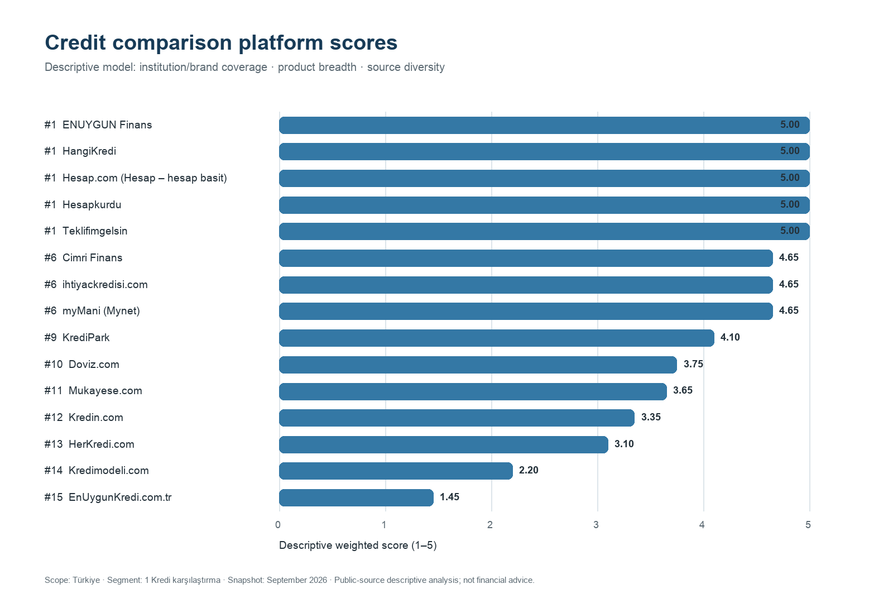
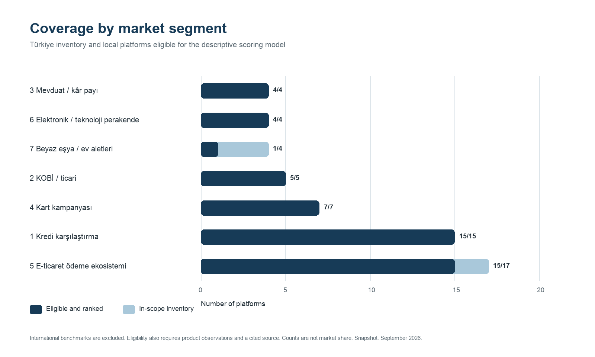

# Financial Platform Benchmarking

A reproducible map of Turkey's financial-platform market, supported by a separate international benchmark set and built from public, date-limited observations. The project compares eligible Turkish platforms only with local peers in the same market segment; it is not a definitive "best platform" list and does not publish a global ranking.

This independent portfolio project contains no confidential employer information and does not recommend any company, credit product, investment, or commercial partnership.

> **Interpretation notice:** This is an exploratory portfolio analysis based on public information collected on the recorded observation dates. Scores describe only the observed institution/brand coverage, product breadth, and source diversity within each market segment. They do not measure overall platform quality, reliability, pricing, user experience, commercial performance, or creditworthiness, and should not be interpreted as an official market ranking or as a financial, product, or partnership recommendation.

## Portfolio summary

- **Problem:** Compare heterogeneous financial-product platforms with consistent, explainable criteria while keeping missing evidence visible.
- **My contribution:** Designed the data model, standardized 914 public-source observations, built the scoring and validation pipeline, and produced reproducible outputs and visuals.
- **Tools:** Python, pandas, Pillow, CSV, `unittest`, Git, and GitHub Actions.
- **Deliverable:** A company-neutral Turkish-market map with documented assumptions, segment-level ranks, and automated release checks.

## Dataset at a glance

- **106** platforms in the inventory: **91** from Türkiye and **15** international benchmarks
- **914** platform-product-institution observations
- **181** source records representing **166** normalized unique URLs in `data/sources.csv`
- **37** supplementary market-reach records
- **7** in-scope market segments

## Key findings

- In the current data snapshot, **106** platforms are mapped: **91** are from Türkiye and **15** are retained separately as `international_benchmark` records.
- Among the Turkish platforms, **56** fall within the seven scoring segments and **35** are retained with `out_of_scope` status.
- The generated `outputs/platform_scores.csv` marks **51** Turkish platforms as `ranked`: each is in scope and has both usable product observations and at least one distinct public source. The remaining **5** in-scope Turkish platforms currently have `needs_product_data` status and stay visible rather than receiving a zero.
- Coverage is uneven across segments, so comparisons are made within a segment only. A single cross-market league table would mix materially different business models.
- Market-reach estimates are retained as supplementary, experimental context. They do not affect scores or eligibility.

These counts describe the committed public-data snapshot, not a permanent market total. Re-running the pipeline updates the generated CSV outputs when the underlying data changes; those outputs are the authoritative source for ranked counts and segment coverage.

## How the pipeline works

1. Standardize platform, product, institution, and source observations.
2. Aggregate distinct institution, product, and public-source counts by platform.
3. Apply the documented three-criterion scoring model.
4. Assign ranks only among eligible platforms in the same market segment.
5. Export analysis-ready CSV files and portfolio visuals.
6. Validate data contracts, release safety, tests, and reproducibility in CI.

## Skills demonstrated

- Data cleaning, normalization, and aggregation
- Exploratory market and competitor analysis
- Transparent weighted-scoring design
- Reproducible Python analysis and automated validation
- Data visualization and technical documentation

## Visual outputs



The credit-comparison chart shows only eligible platforms in that segment; it is not a global ranking.



The coverage chart contrasts the Turkish in-scope inventory with the number of local platforms that currently meet the scoring requirements in each segment. International benchmarks are excluded from these denominators.

## Scoring model

| Criterion | Weight | What it measures |
| --- | ---: | --- |
| Institution/brand coverage | 45% | Distinct institution or financial-brand labels observed for the platform |
| Product breadth | 35% | Distinct financial product types observed |
| Source diversity | 20% | Distinct valid public-source URLs across the observation and source tables |

Each component is converted to a 1-5 score and combined as:

```text
0.45 × institution coverage
+ 0.35 × product breadth
+ 0.20 × source diversity
```

A platform is ranked only when it is from Türkiye, belongs to an in-scope segment, has at least one usable product observation, and has at least one valid public source. `segment_rank` is calculated within its segment; there is no global rank. Missing product or source evidence and international comparators are represented by explicit `ranking_status` values.

Market-reach fields remain in the project for exploratory context, but their estimates are directional, date-dependent, and excluded from the scoring formula.

## Repository structure

```text
data/       Public-source, company-neutral CSV datasets
docs/       Methodology and field definitions
outputs/    Generated segment scores, summaries, and charts
src/        Reproducible scoring, visualization, and validation code
tests/      Boundary and pipeline tests
```

## Run locally

```bash
python3 -m venv .venv
source .venv/bin/activate
pip install -r requirements.txt
python src/score_platforms.py
python src/create_visuals.py
python src/validate_public_release.py
python -m unittest discover -s tests -v
```

## Data provenance and limitations

- Records were collected from publicly accessible platform pages and supporting public web sources on the dates recorded in the dataset.
- Public pages, product ranges, institution coverage, and URLs can change after an observation date.
- Market-reach values are unaudited, experimental estimates and are not used in scoring.
- A listing does not prove an active commercial integration, availability to every user, conversion performance, or product quality.
- Institution coverage counts observed public labels; a bank and its separately branded digital proposition may therefore appear as distinct labels.
- More distinct URLs improve source diversity under this model, but do not by themselves guarantee source quality or independence.
- Results are a reproducible market-mapping snapshot, not financial, credit, investment, or partnership advice.
- The MIT License applies to the repository's code. Third-party facts and source materials remain subject to their original terms.

See the [methodology](docs/methodology.md) for eligibility and score thresholds, and the [data dictionary](docs/data_dictionary.md) for field-level definitions.
