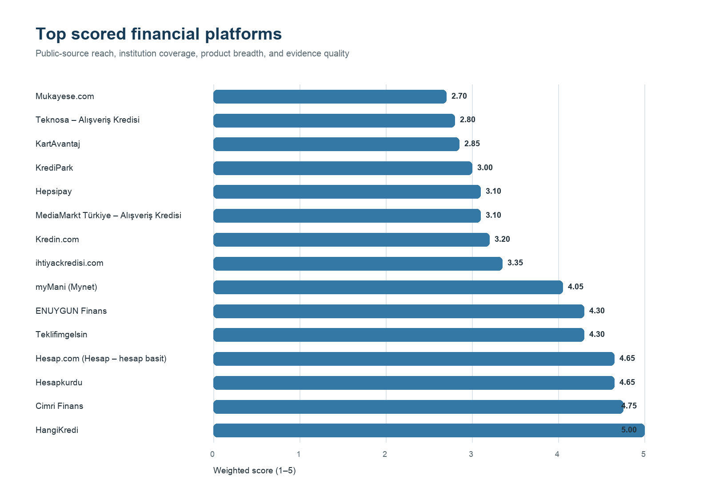

# Financial Platform Benchmarking

A reproducible market-mapping project for comparing financial-product platforms across market reach, institution coverage, product breadth, and evidence quality.

The project was independently developed from publicly available website observations. It is a public portfolio reconstruction and does not contain confidential employer information or recommendations for a specific company.

## Portfolio summary

- **Problem:** Compare financial-product platforms with consistent, explainable criteria despite differences in business model and data availability.
- **My contribution:** Designed the data structure, standardized 914 public-source observations, built the scoring and validation pipeline, and produced analysis-ready outputs and visuals.
- **Tools:** Python, pandas, Matplotlib, CSV, unittest, and Git.
- **Deliverable:** A company-neutral, reproducible repository that keeps missing evidence visible and documents every scoring assumption.

## Dataset at a glance

- **106** platforms in the market inventory
- **914** platform-product-institution observations
- **37** platform reach records
- **181** public source links
- **7** in-scope market segments

## Project overview

The dataset maps financial comparison platforms, marketplace finance products, card-campaign aggregators, deposit and participation-account tools, insurance platforms, and selected e-commerce finance ecosystems.

The pipeline:

1. standardizes platform and product observations;
2. aggregates institution and product coverage;
3. applies a transparent four-criterion scoring model;
4. ranks comparable platforms within their market segment;
5. exports analysis-ready CSV files and portfolio visuals.

## Skills demonstrated

- Data cleaning, normalization, and aggregation
- Exploratory market and competitor analysis
- Transparent weighted-scoring design
- Reproducible Python analysis and automated validation
- Data visualization and technical documentation

## Visual outputs




## Scoring model

| Criterion | Weight | What it measures |
| --- | ---: | --- |
| Market reach | 35% | Estimated monthly visits converted to a five-point band |
| Institution coverage | 30% | Distinct financial institutions observed |
| Product breadth | 25% | Distinct product types observed |
| Evidence completeness | 10% | Records supported by both a source and observation date |

Scores range from 1 to 5. A platform is ranked only when it has a measurable reach value and at least one usable product observation. Missing data remains visible instead of being converted to zero.

## Repository structure

```text
data/       Public-source, company-neutral CSV datasets
docs/       Methodology and field definitions
outputs/    Generated rankings, summaries, and charts
src/        Reproducible scoring, visualization, and validation code
tests/      Boundary tests for the scoring functions
```

## Run locally

```bash
python3 -m venv .venv
source .venv/bin/activate
pip install -r requirements.txt
python src/score_platforms.py
python src/create_visuals.py
python src/validate_public_release.py
python -m unittest discover -s tests
```

## Data provenance and limitations

- Records were collected from publicly accessible platform pages and supporting public web sources.
- Traffic values are estimates tied to the date shown in `data/reach_metrics.csv`; they are not audited figures.
- A platform can change its product or institution coverage after the observation date.
- Rankings are meaningful within the model's stated scope and should not be interpreted as investment, credit, or partnership advice.
- The MIT License applies to the repository's code. Third-party facts and source materials remain subject to their original terms.

See [methodology](docs/methodology.md) for thresholds and [data dictionary](docs/data_dictionary.md) for field-level definitions.
